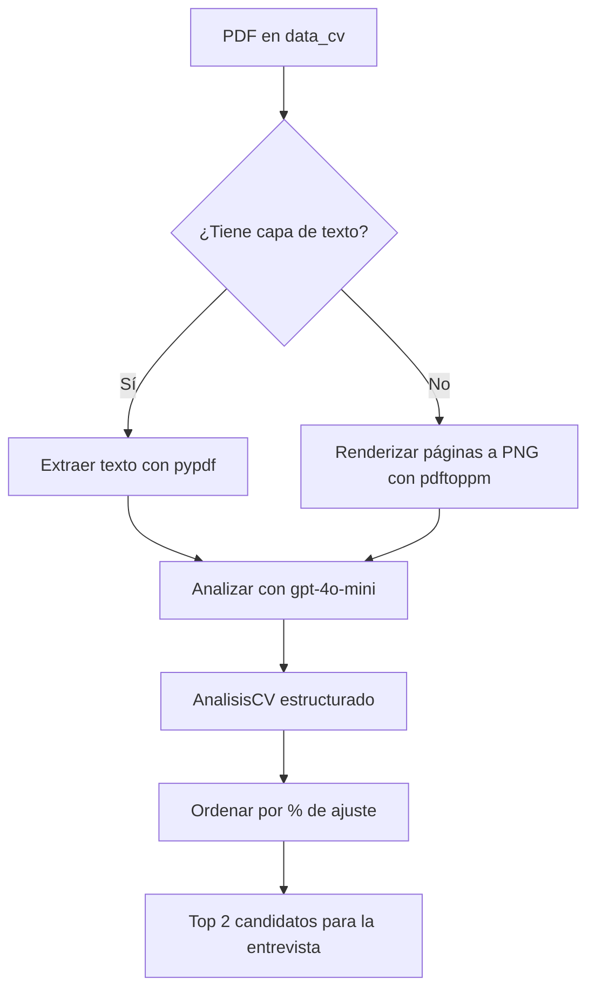

# 🧑‍💼 ProyectoCV Analyzer

Aplicación de Streamlit que analiza currículums en PDF con IA (LangChain + OpenAI)
frente a la descripción de un puesto de trabajo, y selecciona a los **2 mejores
candidatos** para la entrevista final.

## ✨ Características

- **Análisis con IA** de cada CV contra la descripción del puesto (`gpt-4o-mini`, temperatura `0.6`).
- **Lectura robusta de PDF**: intenta extraer la capa de texto y, si el PDF no
  tiene texto (escaneado o con el texto vectorizado), **renderiza las páginas a
  imagen y las analiza por visión** (gpt-4o-mini es multimodal).
- **Selección automática del Top 2** por porcentaje de ajuste.
- Interfaz a **dos columnas**: datos de entrada a la izquierda, resultado del
  análisis a la derecha, con evaluación, perfil, resumen, habilidades, fortalezas
  y áreas de mejora.
- Datos de contacto (teléfono o, en su defecto, correo) de los candidatos elegidos.

## 📁 Estructura

```
ProyectoCV_analyzer2/
├── app.py                 # Interfaz Streamlit (parte visual)
├── config/
│   └── settings.py        # Modelo, temperatura, rutas y constantes globales
├── logica/
│   ├── modelo_cv.py       # Modelo Pydantic del análisis (AnalisisCV)
│   ├── lector_cv.py       # Lectura de PDF: texto -> fallback a visión
│   ├── prompts.py         # Prompts del reclutador
│   └── analizador.py      # Análisis con IA + selección del Top 2
├── data_cv/               # Currículums en PDF de entrada
├── requirements.txt
├── .env.example
└── .gitignore
```

## 🛠️ Requisitos

- Python 3.10+
- **Poppler** (`pdftoppm`) instalado en el sistema — necesario para el modo visión.
  - Debian/Ubuntu: `sudo apt install poppler-utils`
  - macOS: `brew install poppler`
  - Windows: incluir `poppler` en el `PATH`

## 🚀 Instalación y ejecución

```bash
# 1. Crear y activar un entorno virtual
python -m venv .venv
source .venv/bin/activate        # Windows: .venv\Scripts\activate

# 2. Instalar dependencias
pip install -r requirements.txt

# 3. Configurar la API key
cp .env.example .env             # y edita .env con tu clave real

# 4. Coloca tus CVs en PDF dentro de data_cv/

# 5. Ejecutar la app
streamlit run app.py
```

## 🔑 Variables de entorno

| Variable         | Descripción                          |
|------------------|--------------------------------------|
| `OPENAI_API_KEY` | Clave de API de OpenAI (obligatoria) |

El archivo `.env` **no se sube al repositorio** (está en `.gitignore`).

## ⚙️ Configuración

Los parámetros principales se editan en `config/settings.py`:

```python
MODELO_IA = "gpt-4o-mini"
TEMPERATURA = 0.6
TOP_N_CANDIDATOS = 2
UMBRAL_EXCELENTE = 80      # >= 80  -> candidato excelente
UMBRAL_INDIFERENTE = 50    # >= 50  -> candidato indiferente ; < 50 -> deficiente
```

## 🧠 Cómo funciona



1. `logica/lector_cv.py` lee cada PDF: primero intenta el texto; si está vacío,
   usa `pdftoppm` para renderizar a imagen y analizarla por visión.
2. `logica/analizador.py` construye el prompt, llama al modelo con salida
   estructurada (`AnalisisCV`) y ordena los resultados.
3. `app.py` muestra todo en Streamlit y marca los 2 mejores.

## 📝 Notas

- El análisis realiza **una llamada al modelo por cada CV** (los 4 de ejemplo =
  4 llamadas). Pulsa "Analizar candidatos" cuando tengas lista la descripción.
- Si un CV no contiene texto ni se puede renderizar, la app lo indica en la
  columna izquierda.
- Los requisitos de ejemplo para introducir en la aplicación se encuentran en el archivo requisitos_puesto.txt. Todos los datos incluidos como nombres de candidatos, telefonos, correos, etc. son ficticios
